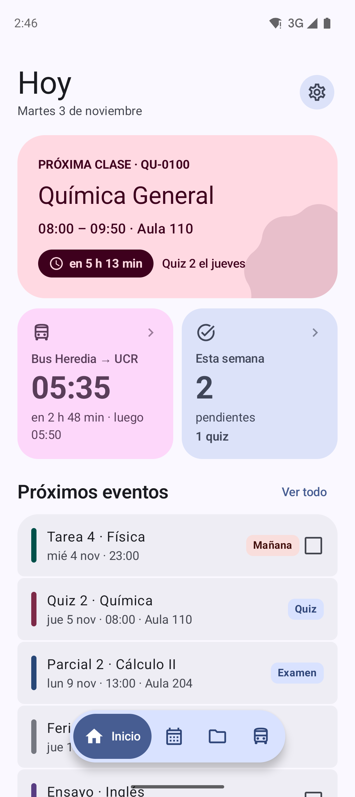
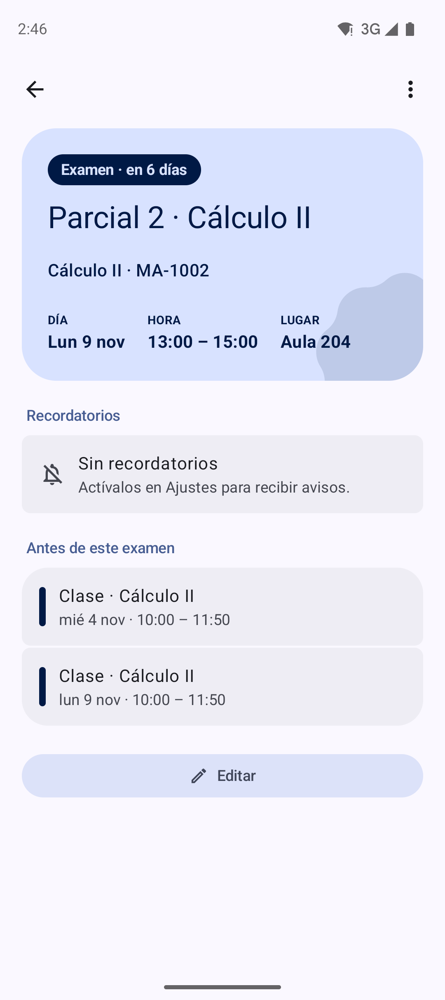
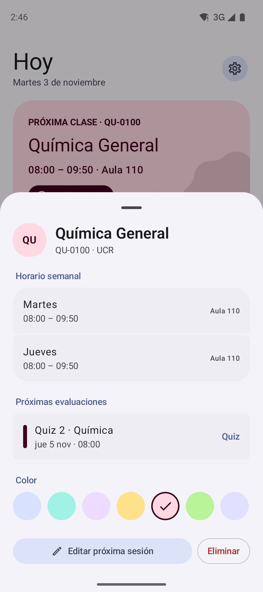
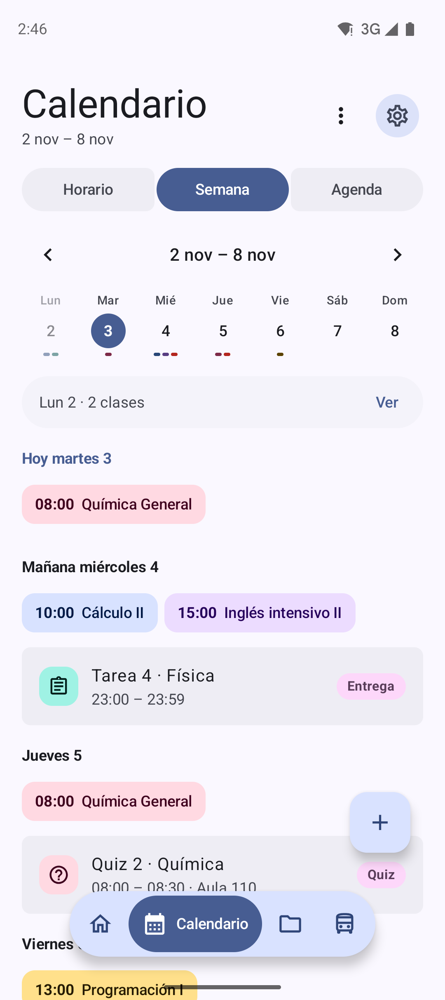
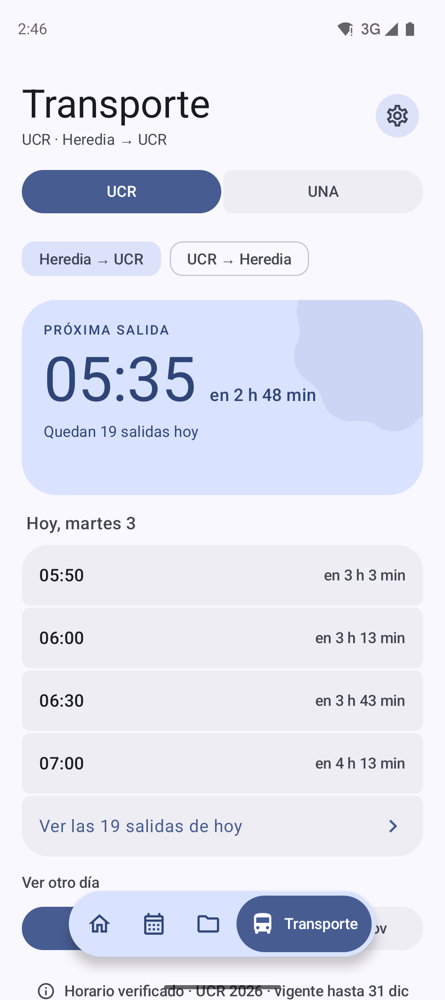
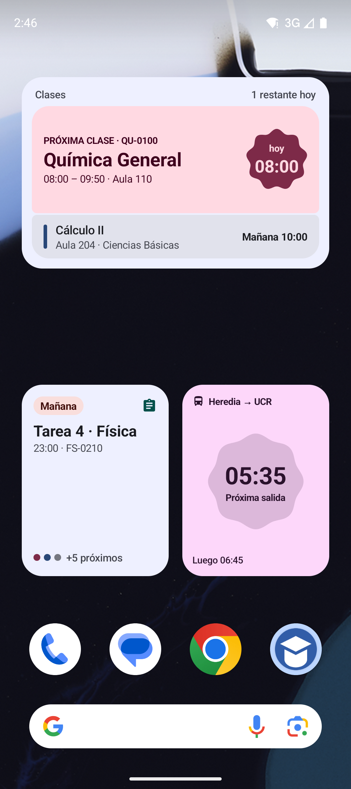
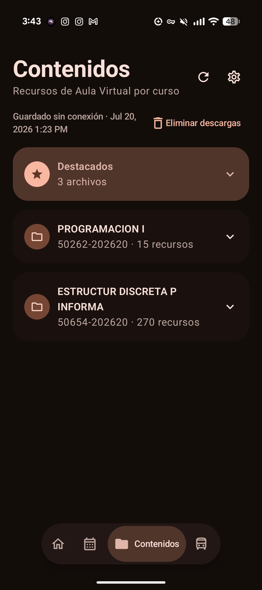
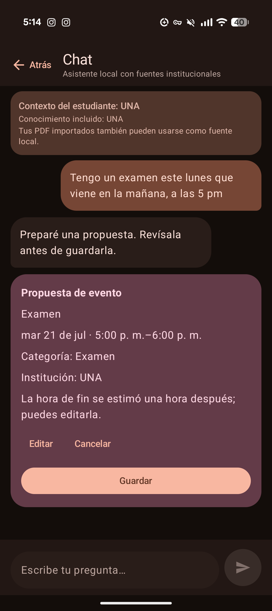

<div align="center">
  
  <h1>Mi Campus</h1>
  <p><strong>Tu vida universitaria, organizada y disponible aun sin conexión.</strong></p>
  <p>Una app Android en español para estudiantes de la UCR y la UNA.</p>

  <p>
    
    
    
    
  </p>
</div>

Mi Campus reúne calendario, horarios de transporte, materiales de curso, recordatorios y asistencia opcional con IA en una experiencia Material 3 Expressive. Está diseñada para mantener los datos del estudiante en el dispositivo por defecto y funcionar sin una cuenta.

## Un vistazo a la app

<table>
  <tr>
    <td align="center"></td>
    <td align="center"></td>
    <td align="center"></td>
  </tr>
  <tr>
    <td align="center"><strong>Inicio</strong><br />La próxima clase, el próximo bus y lo pendiente; todo lleva a su detalle.</td>
    <td align="center"><strong>Eventos</strong><br />Cuándo, dónde, recordatorios y las clases que quedan antes de un examen.</td>
    <td align="center"><strong>Cursos</strong><br />Horario semanal, próximas evaluaciones y color de cada curso.</td>
  </tr>
</table>

<table>
  <tr>
    <td align="center"></td>
    <td align="center"></td>
    <td align="center"></td>
  </tr>
  <tr>
    <td align="center"><strong>Calendario</strong><br />Horario por día, semana y agenda en un solo lugar.</td>
    <td align="center"><strong>Transporte</strong><br />Siempre la próxima salida, aunque sea mañana; disponible sin conexión.</td>
    <td align="center"><strong>Widgets</strong><br />Clases, eventos y buses desde la pantalla de inicio.</td>
  </tr>
</table>

<table>
  <tr>
    <td align="center"></td>
    <td align="center"></td>
  </tr>
  <tr>
    <td align="center"><strong>Contenido</strong><br />Recursos de curso guardados en el dispositivo.</td>
    <td align="center"><strong>Asistente</strong><br />Propuestas editables; nada se guarda sin confirmación.</td>
  </tr>
</table>

## Funciones principales

- Inicio con la próxima clase en el color de su curso, el próximo bus de esa ruta y los eventos pendientes; cada tarjeta lleva a su detalle. En una instalación nueva muestra una lista de primeros pasos: importar un PDF, agregar clases y conectar Aula Virtual.
- Calendario con horario por día, semana y agenda, filtros, recordatorios y exportación idempotente al calendario de Android.
- Página de cada evento con fecha, lugar, notas, recordatorios y, para exámenes y quices, las clases que quedan antes. Las tareas se pueden marcar como hechas: dejan de contar como pendientes y pierden sus recordatorios.
- Ficha de cada curso con su horario semanal, sus próximas evaluaciones y su color.
- Horarios de buses 2026 incluidos en la app, con fuente, cambios por fecha y avisos de vigencia ([servicio externo UCR](https://www.ucr.ac.cr/acerca-u/campus/bus-externo.html) y [servicio de periférica UNA](https://www.vidaestudiantil.una.ac.cr/noticias/2653-servicio-de-periferica-para-estudiantes-desde-el-campus-omar-dengo-al-campus-benjamin-nunez-y-viceversa)).
- Importación múltiple de PDF desde el botón «+» del calendario o desde Inicio, mediante el selector de archivos de Android, extracción de texto en API 35, OCR latino con ML Kit como respaldo, borradores editables y entrada manual.
- Biblioteca privada de documentos y contenido académico disponible sin conexión.
- Gemini Nano local y Google Gemini en la nube como opciones independientes y desactivadas por defecto, con consentimiento por lote o pregunta y clave cifrada proporcionada por el usuario.
- Widgets de clases, eventos y buses con colores por curso y cuenta regresiva.
- Ajustes organizados en páginas cortas (universidades, cuentas, recordatorios, apariencia, IA y privacidad) que muestran su estado sin entrar.
- Temas claro, oscuro y de color dinámico, además de diseños compactos y expandidos.

> [!NOTE]
> No se incluyen entradas de calendario académico hasta contar con un conjunto de datos oficial y versionado. El conocimiento institucional integrado cubre actualmente material de la UNA; para consultas específicas de la UCR se necesita un documento importado relevante.

## Asistente y creación de eventos

El chat funciona incluso sin importar un PDF. Usa las instituciones seleccionadas como contexto privado sin modificar el mensaje visible del estudiante, filtra las fuentes por institución y solo abre enlaces `http` o `https` exactos encontrados en el material seleccionado.

Las expresiones de horario y los comandos `/crear-evento` o `/create-event` generan una propuesta editable. El estudiante debe confirmarla antes de que se guarde o programe cualquier recordatorio.

## Tecnología

| Área | Implementación |
| --- | --- |
| UI | Kotlin, Jetpack Compose y Material 3 Expressive |
| Widgets | Jetpack Glance |
| Datos locales | Room y DataStore |
| Tareas | WorkManager |
| IA local | Gemini Nano mediante AICore y ML Kit GenAI |
| Rendimiento | R8 en la versión de lanzamiento y perfil de referencia (Baseline Profile) |
| Compatibilidad | Android API 26–36 |

## Construido con Codex y GPT‑5.6

Mi Campus fue diseñado, implementado y depurado con Codex usando GPT‑5.6 durante Build Week. Codex funcionó como colaborador de ingeniería desde la concepción hasta la implementación final, mientras GPT‑5.6 aportó el razonamiento para conectar decisiones de producto, arquitectura, privacidad y código.

GPT‑5.6 se utilizó mediante Codex para investigar APIs, comparar alternativas técnicas, definir la arquitectura offline-first, implementar funciones entre varias capas, crear pruebas e interpretar errores de builds y dispositivos reales. Fue especialmente útil para desarrollar la integración con Moodle que conecta Aula Virtual, implementar Gemini Nano, proteger sesiones y consentimiento, y validar borradores antes de guardar eventos. El trabajo avanzó en ciclos verificables de implementación, lint, pruebas, compilación y corrección: GPT‑5.6 interpretaba la intención, analizaba la evidencia y refinaba las soluciones, mientras las decisiones de producto, privacidad, control de calidad y aceptación final permanecieron bajo supervisión humana.

## Compilar y verificar

Se necesita JDK 17 y un Android SDK con la plataforma 37:

```bash
./gradlew lint testDebugUnitTest assembleDebug
```

Con un emulador o dispositivo conectado:

```bash
./gradlew connectedDebugAndroidTest
```

El perfil de referencia vive en `app/src/release/generated/baselineProfiles/` y se regenera con un emulador o dispositivo conectado:

```bash
./gradlew :app:generateBaselineProfile
```

GitHub Actions ejecuta lint, pruebas unitarias y la compilación de depuración. Las pruebas de dispositivo se pueden ejecutar localmente. Una etiqueta `v*` crea una GitHub Release firmada mediante los secretos configurados y adjunta el APK junto con su suma SHA-256. El APK de depuración queda en `app/build/outputs/apk/debug/app-debug.apk`.

## Privacidad por diseño

- La app funciona sin una cuenta.
- Los PDF se guardan únicamente en almacenamiento privado y excluido de copias de seguridad hasta que el estudiante los elimina.
- El texto extraído se almacena localmente en Room y se elimina junto con el PDF.
- Ambos procesadores de IA están desactivados en una instalación nueva.
- El procesamiento en la nube requiere una decisión nueva para cada lote de importación y cada pregunta del chat.
- El PDF original nunca se envía a la nube.

Consulta [PRIVACY.md](PRIVACY.md) e [IMPLEMENTATION_NOTES.md](IMPLEMENTATION_NOTES.md) para conocer los detalles técnicos y de tratamiento de datos.

## Gemini Nano en dispositivos compatibles

Mi Campus usa `com.google.mlkit:genai-prompt:1.0.0-beta3` mediante AICore y no incluye pesos del modelo. Las propuestas de eventos usan ML Kit Structured Output (`genai-schema-compiler:1.0.0-alpha1`) cuando el entorno lo admite y, en caso contrario, JSON restringido con validación estricta.

La compatibilidad se determina en tiempo de ejecución con `checkStatus()`. La primera descarga del modelo requiere conexión y confirmación explícita; después, la extracción de eventos puede funcionar sin conexión mientras Mi Campus permanece en primer plano.

La prueba opcional no inicia descargas, omite automáticamente dispositivos incompatibles y se ejecuta así cuando el modelo ya está disponible:

```bash
./gradlew connectedDebugAndroidTest -Pandroid.testInstrumentationRunnerArguments.runNanoDeviceTest=true
```

Las compilaciones de depuración también incluyen **Ajustes → Diagnóstico de importación** y la acción **Probar Gemini Nano**. El ZIP de diagnóstico contiene únicamente trazas permitidas y redactadas: nunca incluye texto de PDF, prompts, respuestas, nombres de documentos, claves API ni datos del calendario.
